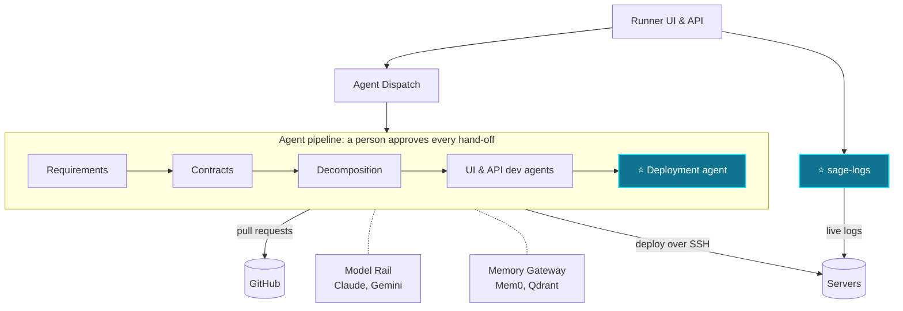

  

<h1 align="center">Hi there 👋, I'm Harinath Reddy Gunda</h1>
<h3 align="center">🚀 DevOps Engineer | ☁️ Microsoft Certified Azure Administrator (AZ-104) | 🤖 AI Agents & Automation</h3>

  <a href="https://harinath-devops-portfolio.vercel.app"><b>🌐 Portfolio</b></a> &nbsp;•&nbsp;
  <a href="https://harinath-devops-portfolio.vercel.app/resume.pdf"><b>📄 Resume</b></a> &nbsp;•&nbsp;
  <a href="https://www.linkedin.com/in/harinath-reddy-gunda-88178123a/"><b>💼 LinkedIn</b></a> &nbsp;•&nbsp;
  <a href="mailto:harinathreddygundareddy@gmail.com"><b>📧 Email</b></a>

---

  
  
  
  
  
  
  

  
  

---

# 👨‍💻 About Me

<table>
<tr>
<td width="60%" valign="top">

### 🚀 DevOps Engineer Building Scalable Systems

I design, automate, and optimize infrastructure for reliability and performance.

🔹 Passionate about **CI/CD, Cloud Infrastructure & Automation**  
🔹 **Microsoft Certified Azure Administrator Associate (AZ-104)** and Azure Fundamentals (AZ-900)  
🔹 Strong believer in Infrastructure as Code & DevSecOps  
🔹 Building **AI-agent deployment automation** for an agentic SDLC platform  
🔹 Python enthusiast building automation & AI-driven workflows  

I focus on building systems that are:

- ⚙️ Automated  
- ☁️ Cloud-Native  
- 📊 Observable  
- 🔐 Secure  
- 🤖 AI-Ready  

</td>

<td width="40%" align="center">

</td>
</tr>
</table>

---

# 🏅 Certifications

| Certification | Exam | Earned | Verify |
|---|---|---|---|
| **Microsoft Certified: Azure Administrator Associate** | AZ-104 | Sep 2026 (valid through Sep 2027) | [🔗 Verify on Microsoft Learn](https://learn.microsoft.com/api/credentials/share/en-us/HarinathReddyGunda-0272/43566C544B4D6BB8?sharingId=71F47DBC41D416ED) |
| **Microsoft Certified: Azure Fundamentals** | AZ-900 | May 2026 | [🔗 Verify on Microsoft Learn](https://learn.microsoft.com/api/credentials/share/en-us/HarinathReddyGunda-0272/45A922D3D9B18E6A?sharingId=71F47DBC41D416ED) |

AZ-104 covers Azure identities and governance, storage, compute, virtual networking, and monitoring and backup.

---

# 💼 Professional Experience

## 🏢 Techno Consulting Services  
### DevOps Engineer (Remote)  
📅 July 2024 – Present  

Promoted from Intern to Full-Time DevOps Engineer within 2 months.

### 🔧 Key Responsibilities

- 🤖 Since March 2026, building deployment automation and Google Cloud and LLM infrastructure for **Sage**, the agentic SDLC platform from [SDLCAgents.ai](https://sdlcagents.ai)
- 🚀 Designed & maintained CI/CD pipelines using Azure DevOps & Jenkins
- ☁️ Managed multi-cloud environments (Azure, AWS, GCP)
- 🐳 Containerized microservices with Docker & deployed via Kubernetes
- 📊 Implemented observability using Prometheus, Grafana & Azure Monitor
- 🔐 Integrated HashiCorp Vault for secure secrets management
- 🏗️ Automated infrastructure provisioning using Terraform
- 🔁 Implemented Git-based workflows & branch strategies
- 🤝 Collaborated using Azure Boards & JIRA in Agile teams

### 📈 Impact

| Result | How |
|---|---|
| **99.9%** service availability | Proactive monitoring and reliability engineering |
| **35%** faster builds and deployments | Reusable pipeline templates and deployment standards |
| **30%** lower MTTR | Centralized Prometheus, Grafana, Loki and Alertmanager |
| **30%** higher deployment success rate | CI/CD standardization across 2 enterprise projects |
| **40%** fewer manual configuration errors | Secure, repeatable practices on 15+ on-prem servers |
| **25%** fewer release issues and rollbacks | Streamlined delivery with dev, QA and product teams |

---

# 🚧 Currently Building: Sage – Agentic SDLC Platform

Sage takes software from **business requirements to deployed code using AI agents**, with a **human approval between every stage**. It's a product of **SDLCAgents.ai** that I've been building at Techno Consulting Services since **March 2026**, and it's in active development.

⭐ = built by me

**What I built**

- 🚀 **Deployment agent** (primary author): generates a repository's Docker, Compose and nginx files, proves them in CI, deploys over SSH and raises a pull request. It handles Docker and non-Docker deployments, microservices, micro-frontends, and new or existing databases.
- 🔐 **Safety by design**: safety-critical steps are written in code, not left to the model. Secrets are never shown to the LLM, plans are checked against repository evidence, generation stops after three failed attempts, and no sudo is used on servers.
- 📜 **sage-logs**: a standalone NestJS service that streams live and historical PM2, Docker and systemd logs over one reconnecting SSH connection, using only scoped SSH access and allow-listed systemd units.
- ☁️ **Google Cloud from scratch**: VPC, Artifact Registry, IAM, service accounts and Secret Manager, with AI agents deployed to Cloud Run using OIDC service-to-service authentication.
- 🧠 **LLM infrastructure**: managed Model Rail, the internal multi-provider LLM gateway, with LiteLLM, AWS Bedrock and Ollama; benchmarked LLMs with vLLM on GPU instances and fine-tuned small language models.
- 🖥️ **Linux servers**: Ubuntu 24.04 across dev, QA and production with PM2, systemd, nginx, PostgreSQL, DNS and SSL via Certbot.
- 🧭 Mapped the service and agent hierarchy and added per-repository deployment fan-out to the orchestrator.
- 🔁 CI/CD across environments with Azure Pipelines, GitHub Actions (multi-stage Docker builds pushed to Artifact Registry), SonarQube and obfuscated builds.

**Results:** ✅ 561 automated tests passing · 🔀 50+ merged pull requests · 🌐 live deployments of a full-stack app and a two-service backend

**Stack:** Python · TypeScript · FastAPI · NestJS · Next.js · Claude · Gemini · Claude Code · LiteLLM · vLLM · AWS Bedrock · Ollama · Mem0 · PostgreSQL · Redis · Qdrant · Docker · Google Cloud Run · Artifact Registry

---

# 🗂️ Client Projects

**🖥️ SC@FT – Super Computer at Finger Tips** · A*STAR · Mar 2025 – Jan 2026
- Jenkins master–agent CI/CD for 10+ backend services on on-prem RedHat servers in a VPN-secured data center
- Migrated repositories from GitHub to client-managed GitLab with full commit history
- Prometheus, Grafana, Node Exporter, Loki and Alertmanager monitoring that cut MTTR by 30%, with Vault secrets management and Keycloak

**📦 ARC Parcel Service** · The Annamalaiss Group · Sep 2024 – Jan 2026
- Azure DevOps YAML pipelines for React.js and Node.js apps, with DEV → UAT → PROD approval gates
- Docker deployments to AlmaLinux servers through self-hosted Azure DevOps agents in a private network
- SonarQube, pull request and build validation policies that reduced failures by 30%

---

# 🧪 Open-Source Work

| Repository | What it does |
|---|---|
| [CI-CD-Automation](https://github.com/Harinathreddygunda/CI-CD-Automation) | Python tool that uses the Azure DevOps and GitHub REST APIs to create a YAML pipeline for a GitHub repo (or find the existing one) and trigger it automatically |
| [github-pr-audit](https://github.com/Harinathreddygunda/github-pr-audit) | Python script that audits pull requests, commits and reviews across GitHub repos and writes a daily Excel report |
| [GHA-RE-USABLE_Workflow](https://github.com/Harinathreddygunda/GHA-RE-USABLE_Workflow) | Reusable GitHub Actions workflow with a caller workflow |
| [Github.Actions](https://github.com/Harinathreddygunda/Github.Actions) | Exploring GitHub Actions and workflow features |
| [kubernetes-k8s](https://github.com/Harinathreddygunda/kubernetes-k8s) | Kubernetes notes and manifests: architecture, kind clusters, ReplicationControllers, ReplicaSets, Deployments and Docker fundamentals |
| [Python_For_DevOps](https://github.com/Harinathreddygunda/Python_For_DevOps) | Python from scratch, aimed at DevOps automation |
| [🌐 Portfolio website](https://harinath-devops-portfolio.vercel.app) | My portfolio, built with Next.js, Tailwind CSS and three.js and deployed on Vercel |

---

# 🤖 DevOps + AI Exploration

Alongside building Sage, I keep exploring the intersection of **DevOps & AI**:

- 🧠 Large Language Models (LLMs)
- 🤖 Agentic AI architectures
- 🛠️ AI Agents for automation
- 📡 Observability for AI systems
- ⚙️ Python-based AI orchestration tools

Learning & experimenting with:
- LangChain
- LangGraph
- OpenTelemetry
- Model evaluation & monitoring concepts

---

# 🛠️ Tools & Technologies

## ☁️ Cloud & Infrastructure

## 🐳 Containers & Orchestration

## 🔁 CI/CD & Automation

## 📊 Observability & Monitoring

## 🔐 Security & DevSecOps

## 🖥️ Scripting & Development

## 🤖 AI & Agents
Claude · Claude Code · Gemini · LiteLLM · vLLM · AWS Bedrock · Ollama · Mem0 · Qdrant · FastAPI · NestJS

---

# 📈 GitHub Stats
<!-- 

 -->

---

# 📫 Connect With Me

- 📍 Hyderabad, Telangana, India  
- 🌐 Portfolio: https://harinath-devops-portfolio.vercel.app  
- 📄 Resume: https://harinath-devops-portfolio.vercel.app/resume.pdf  
- 💼 LinkedIn: https://www.linkedin.com/in/harinath-reddy-gunda-88178123a/  
- 📧 Email: harinathreddygundareddy@gmail.com  
- 🧑‍💻 GitHub: https://github.com/Harinathreddygunda  

---

# 💡 DevOps = Automation + Reliability + Continuous Learning

  

